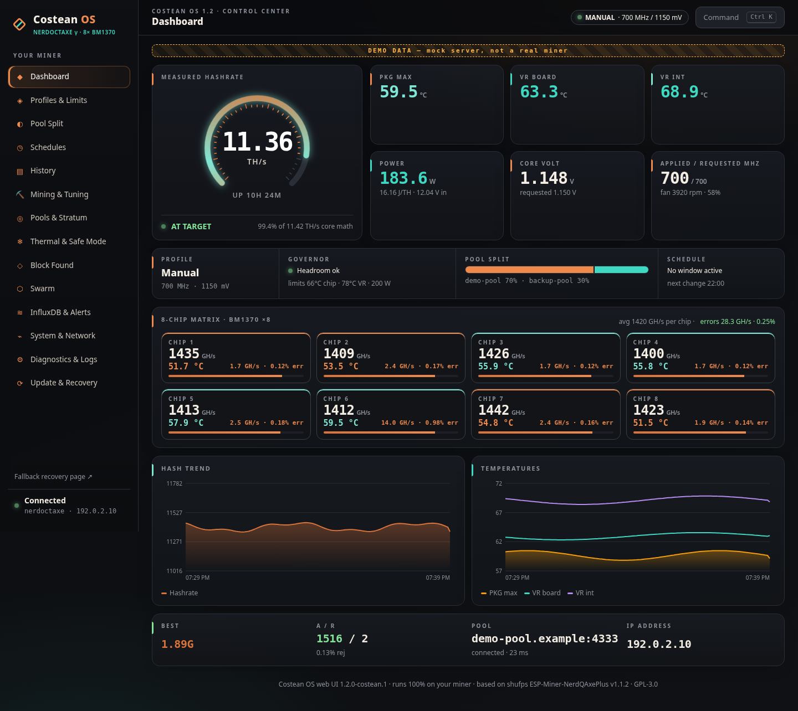
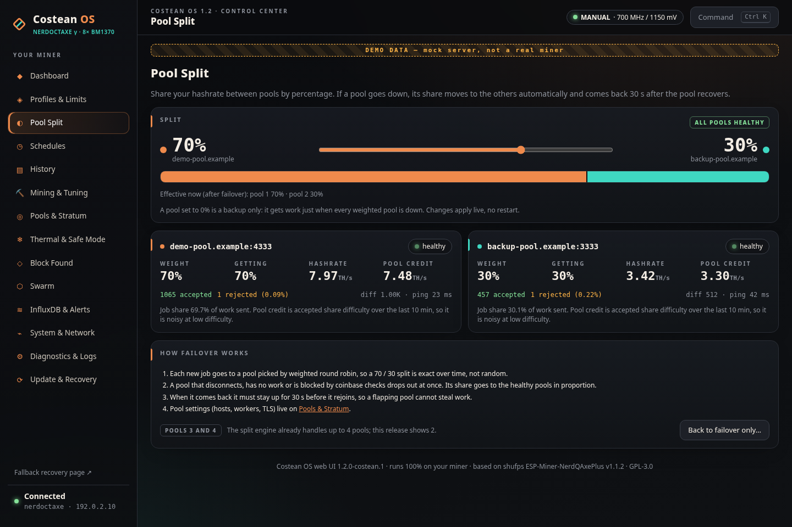
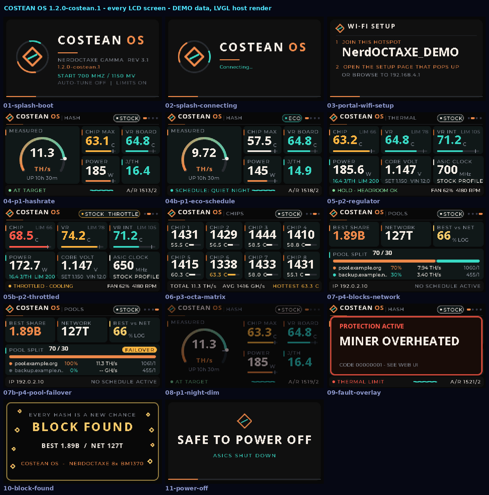

# Costean OS for the NerdOctAxe Gamma

> [!WARNING]
> **For the NerdOctAxe Gamma (Rev 3.1, 8x BM1370, ESP32-S3, 16 MB flash, 320x170 LCD) only.** Do not flash it on any other board.
>
> **Not tested by the authors on every board. Flash at your own risk.** The web UI was tested against a demo mock API, the LCD screens were checked in an LVGL host render with demo data, and the new governor, scheduler and pool split logic have host unit tests. **The 1.2.0 features have not been run on a real miner yet.** Keep the stock recovery image handy (see [Recovery](#recovery-back-to-stock-v112)).

Costean OS is a custom firmware for the NerdOctAxe Gamma. (A *costean*, pronounced COS-teen, is an old mining word for a trench dug to find the lode.) It is a source fork of [shufps/ESP-Miner-NerdQAxePlus](https://github.com/shufps/ESP-Miner-NerdQAxePlus) **v1.1.2** (GPL-3.0) with a new LCD UI, a new web UI, profiles with protective limits, schedules, long history and a multi-pool split. It is the NerdOctAxe sibling of [Costean OS for the Bitaxe Gamma 602](https://github.com/Costean/costean-os) and [Costean OS for the NexusL1](https://github.com/Costean/costean-os-nexusl1).

Version: **1.2.0-costean.1** (experimental), built with **ESP-IDF v5.3.6**.

### New in 1.2.0-costean.1

- **New "Lode" look** on the LCD and in the web UI: graphite panels, copper and teal accents, cream text, a diamond-and-vein logo.
- **Profiles: Eco, Stock, Turbo and Manual.** Manual (the default) keeps your own saved frequency and voltage, so nothing changes after the update until you pick a profile.
- **Protective limits that throttle instead of crashing**: hottest chip, voltage regulator and board power. Over a limit the clock steps down; it climbs back once there is room. The stock overheat shutdown stays on underneath.
- **Careful auto-tune (off by default)**: frequency only, never voltage; needs temperature headroom; backs off on chip errors, rejected shares or heat, and never retries a step that failed.
- **Schedules**: up to 8 weekly time windows that switch the profile and/or the screen (normal, dim, off). Own time zone rules, so it works without internet time zone data. Default: the screen dims 22:00-07:00, like before.
- **History that survives a reboot**: 48 hours of 15-minute points (hashrate, power, temperatures, J/TH, throttle / failover / schedule marks), kept in flash.
- **Multi pool split**: share hashrate between pools by percentage, with per-pool hashrate and accepted / rejected shares. If a pool goes down its share moves to the others and comes back 30 s after it recovers. 2 pools in the UI; the split engine handles up to 4.







**Not affiliated with, or endorsed by, the NerdQAxe / NerdOctAxe or Bitaxe projects.**

## Features

### Unchanged from upstream (hard rules)

- Mining code, ASIC driver, stratum protocol, fan control and the thermal shutdown are the **stock v1.1.2** code. Costean OS only sets the operating point (frequency / voltage) through the stock power management, and picks which pool gets each new job in dual pool mode.
- No dev fee and no new hardcoded pool. A factory install starts on the upstream default pool (`public-pool.io:3333` with the upstream example address), so set **your own pool and wallet** right away.
- Absolute frequency / voltage limits are unchanged. Profiles and auto-tune stay inside the board's own frequency and voltage lists.

### Safe start and safe defaults

- Board defaults are **700 MHz / 1150 mV** on the 6-phase TPS53667 board (upstream: 700 MHz / 1210 mV). The 4-phase TPS53647 board keeps the upstream **600 MHz / 1150 mV**.
- The one-time safe start from 1.1.2-costean.1 (saved settings above 700 / 1150 lowered once) is **not** run again when you update from 1.1.2-costean.1; it runs once on a first install.
- Profile **Manual**, auto-tune **off**, limits **68 °C** chip / **85 °C** regulator / **200 W** board power (170 W on the 4-phase board). A limit is never set above 2 °C below the stock overheat shutdown.

### Profiles and protective limits

| Profile | 6-phase board | What it is |
|---|---|---|
| Eco | 600 MHz / 1100 mV (or the board's eco point) | Quieter, cooler, best J/TH |
| Stock | the board default (700 / 1150) | The maker's operating point |
| Turbo | stock + 50 MHz / + 30 mV (750 / 1180), clamped to the board lists | A modest step up; needs typing `TURBO` to confirm |
| Manual | your saved frequency / voltage | Same as before the update |

The governor runs every 5 s on the miner. Over a limit it first gives back any auto-tune steps, then lowers the clock 25 MHz every 20 s down to the lowest frequency in the board list (voltage stays at the profile value). Once every reading is more than 4 °C below its limit (and power below 95 % of its limit) it climbs back 25 MHz every 2 minutes. The applied point is a runtime override and is never written to flash, so a reboot always starts from your profile.

### Auto-tune (off by default)

Raises the clock one 25 MHz step at a time, at most 2 steps (1-4), only with at least 6 °C of headroom to every limit, and holds each step for 15 minutes (5-120) to prove it is stable. Voltage is never raised. It backs off if chip hardware errors go above 1 % or rejected shares above 1 % (both adjustable), or if a limit is reached, and remembers the failed step so it never retries it. Changing profile starts it over. Turning it on needs typing `AUTO-TUNE` to confirm.

### Schedules

Up to 8 windows, each with days of the week, a start and end time (a window that ends before it starts runs past midnight), a profile (or no change) and a screen mode (normal, dim, off). When windows overlap the lowest-power profile and the darkest screen win. Time zones: UTC, St. John's, Halifax, New York, Toronto, Chicago, Denver, Phoenix, Los Angeles, Vancouver, London, Berlin and Helsinki, with their daylight time rules built in (default America/New_York). Nothing is switched until the miner has network time. A scheduled "off" screen turns the backlight off; any button press wakes it for 30 s.

### History

192 points of 15 minutes (48 h): hashrate, board power, hottest chip, regulator temperature, J/TH and flags. Saved to flash every 30 minutes and right before a restart (about 1.5 KB, CRC-checked), so it survives a reboot. Gaps (miner off or not mining) are shown as gaps.

### Multi pool split

Turn on **dual pool** mode (needs a restart), then set the split on the **Pool Split** page; split changes apply live. Each new job goes to a pool by smooth weighted round robin, so a 70 / 30 split is exact over time. A pool that disconnects, has no work, or is blocked by coinbase verification drops out at once and its share is spread over the healthy pools in proportion; it must stay up for 30 s before it rejoins. A pool set to 0 % is a backup only. Each pool shows its weight, the share it is getting now, its hashrate (by job share), the pool-credited hashrate (accepted share difficulty over 10 minutes), accepted / rejected shares and reject %.

### LCD (320x170)

Code-drawn LVGL screens (no bitmaps) in `main/displays/ui_octa.cpp`, on the stock screen state machine. The stock LCD UI is still compiled in and can be selected in `main/displays/ui_select.h`.

- Boot and connecting splash, Wi-Fi setup page (hotspot name, `192.168.4.1`).
- Header on every page: logo, page name, profile chip (ECO / STOCK / TURBO / MANUAL, plus THROTTLE, TUNE or BACKED OFF), page dots.
- Page 1/4 **HASH**: hashrate gauge, hottest chip, VR board, power and J/TH with limit bars, status (at target, schedule window, throttling), trend, accepted / rejected.
- Page 2/4 **THERMAL**: chip / VR / VR internal temperatures against their limits, power, core voltage (measured and set), ASIC clock and profile, governor state, fan.
- Page 3/4 **CHIPS**: 8-chip matrix with hashrate and temperature, total, average and hottest chip.
- Page 4/4 **POOLS**: best share, network difficulty, best-vs-network, the pool split bar with per-pool share, hashrate and accepted / rejected, a FAILOVER badge, IP and the active schedule window.
- Block found, fault / protection overlay and "safe to power off" screens. Night dimming follows the schedule.

### Web UI (Costean OS control center)

Svelte 5 UI in `main/http_server/costean-ui`:

- **Dashboard** with a Costean strip (profile, governor, pool split, schedule), hashrate gauge, temperatures, 8-chip matrix with per-chip hardware-error %, trends.
- New pages: **Profiles & Limits**, **Pool Split**, **Schedules** (with a week-at-a-glance grid), **History** (48 h charts).
- **Mining & Tuning** (manual frequency / voltage, per-ASIC error table), **Pools & Stratum**, **Thermal & Safe Mode**, **Block Found**, **Swarm**, **InfluxDB & Alerts**, **System & Network**, **Diagnostics & Logs**, **Update & Recovery** (plus the stock `/recovery` page).
- Every change shows what will be sent and asks to confirm; above-stock changes need a typed phrase; OTP is supported.

New API: `GET /api/costean` (status and settings), `GET /api/costean/history`, `PATCH /api/costean` (validated; returns 400 with a reason). The dashboard pool JSON gains `splitWeight`, `splitEffective`, `splitHealthy`, `jobShare`, `assignedHashrate`, `creditedHashrate` and `splitFailover`.

More screenshots (all demo data, never a real miner) are in [`docs/screenshots/`](docs/screenshots/).

## Downloads

Get the files from the [Releases](../../releases) page.

| File | What it is |
|------|------------|
| `esp-miner-factory-NerdOCTAXE-Gamma-v1.2.0-costean.1.bin` | Full factory image (bootloader, partition table, app, web UI, otadata; empty NVS). Flash at **0x0**. **This wipes all settings.** |
| `esp-miner-factory-NerdOCTAXE-Gamma-v1.2.0-costean.1.zip` | The same factory image zipped (easier to download on a phone). Unzip before flashing. |
| `esp-miner-NerdOCTAXE-Gamma.bin` | OTA app image. Keeps your settings. Named like the stock file so the stock update page accepts it. |
| `www.bin` | Web UI (3 MB SPIFFS partition). Keeps your settings. |
| `SHA256SUMS` | SHA-256 of each file. Check with `sha256sum -c SHA256SUMS`. |

## Install

### Option A: OTA update (keeps settings)

1. Open the miner's web UI and go to the update page (stock **Settings / Update**, or Costean OS **Update & Recovery**).
2. Upload `esp-miner-NerdOCTAXE-Gamma.bin` as the **firmware** and wait for the reboot.
3. Upload `www.bin` as the **web UI**, then reload the page.

Upload **both** files, as a pair. The web UI warns you if the firmware and web UI versions do not match.

### Option B: factory image at 0x0 (clean install, wipes settings)

```bash
esptool --chip esp32s3 -p PORT -b 460800 write-flash 0x0 esp-miner-factory-NerdOCTAXE-Gamma-v1.2.0-costean.1.bin
```

Or use [esptool-js](https://espressif.github.io/esptool-js/) and flash the factory file at `0x0`. After a clean install the miner opens its setup hotspot; connect to it and browse to `http://192.168.4.1` to enter Wi-Fi and **your own pool and wallet**.

## Recovery back to stock v1.1.2

Costean OS does not re-host the stock binaries. Get them from the official release: <https://github.com/shufps/ESP-Miner-NerdQAxePlus/releases/tag/v1.1.2>

- OTA (keeps settings): upload the stock `esp-miner-NerdOCTAXE-Gamma.bin` (SHA-256 `d1d99529b09dd55b53fead68f83918a58d0ed8b679367151f57415840d23e74b`), then the stock `www.bin` (SHA-256 `8bfefe9b25a8d276a742d7b0a06cd11ad2d5a0be28e52568abd9e4ba9767f80a`).
- USB (wipes settings): flash `esp-miner-factory-NerdOCTAXE-Gamma-v1.1.2.bin` at `0x0` (SHA-256 `267a711c4253f431c8aa64ef3d85cfabeb13117e00b119eb194d78143a227f5b`).

## Build from source

```bash
git clone --recursive https://github.com/Costean/costean-os-nerdoctaxe.git
cd costean-os-nerdoctaxe/main/http_server/costean-ui
npm ci && npm test && npm run build      # web UI -> dist/axe-os
cd ../../..
# ESP-IDF v5.3.6 environment
BOARD=NERDOCTAXEGAMMA GITHUB_ACTIONS=true idf.py set-target esp32s3 build
```

`GITHUB_ACTIONS=true` makes the build pack the prebuilt `dist/axe-os` into `www.bin` instead of running npm itself. Host tests for the safe-start and LCD logic: `c++ -std=c++17 -I main test/host/safe_boot_test.cpp && ./a.out` (same for `octa_logic_test.cpp`). Unit tests for the pool split, scheduler, governor and history (AddressSanitizer + UBSan): `test/costean/run.sh`. The LCD object-lifetime stress test (LVGL host build with AddressSanitizer) is in `test/lcd-lifetime/`. `npm run mock` in the web UI folder starts a demo API on port 8099. The upstream README is kept in [`docs/ESP-MINER-NERDQAXEPLUS-UPSTREAM-README.md`](docs/ESP-MINER-NERDQAXEPLUS-UPSTREAM-README.md).

## Known limits

- Not tested by the authors on every board revision. Check hashrate, temperatures and fan after flashing.
- The 1.2.0 governor, auto-tune, schedules, scheduled screen-off and pool split have only been tested on the host (unit tests, demo API, LVGL render), not yet on a real miner.
- Switching between failover and dual pool mode needs a restart. Pools 3 and 4 are not in the UI yet.
- History is lost if the miner loses power between saves (at most the last 30 minutes).
- Schedule time zones are limited to the list above.
- The original Angular AxeOS UI source is still in `main/http_server/axe-os` but is not built.

## Credits and license

Costean OS is based on [shufps/ESP-Miner-NerdQAxePlus](https://github.com/shufps/ESP-Miner-NerdQAxePlus) by shufps and the NerdQAxe contributors, which is itself based on [bitaxeorg/ESP-Miner](https://github.com/bitaxeorg/ESP-Miner) by the Bitaxe / OSMU contributors. All upstream history is kept in this repository. The firmware is licensed under the GNU General Public License v3.0, and so is Costean OS; see [LICENSE](LICENSE). The Costean web UI is GPL-3.0-or-later.

This is an unofficial fork and is not affiliated with or endorsed by the NerdQAxe / NerdOctAxe or Bitaxe projects. All product names belong to their owners.
